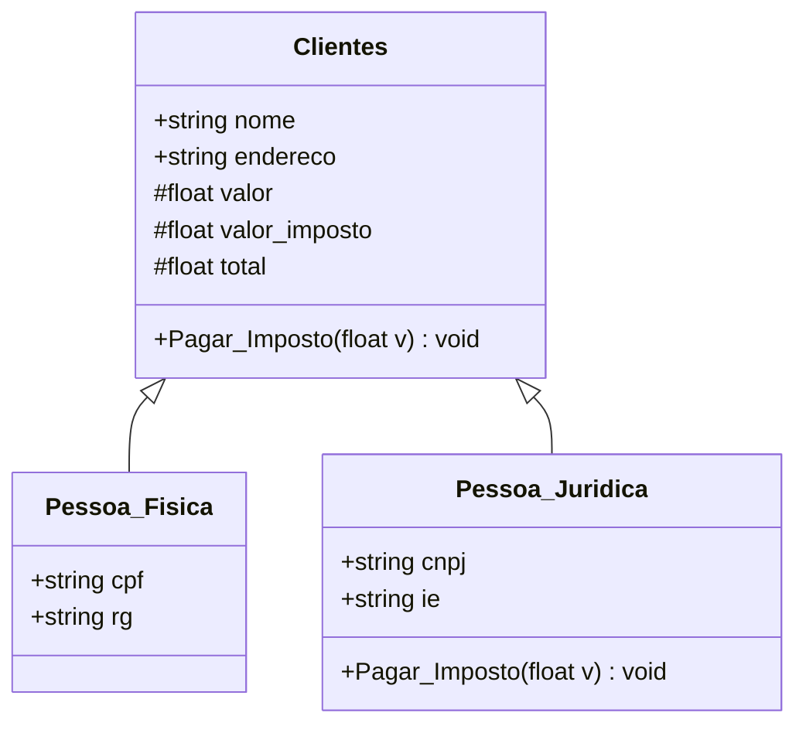

# Sistema de Controle de Clientes – ClientLab

**Autor:** Marcelo Ferreira Batista ([@marcelofbatista](https://github.com/marcelofbatista))<br>
**Contexto:** Codificação Back-End – SENAI, Qualificação em Programador Full-Stack (turma CTMSP_DDF_QO_FULLST_252T10)<br>
**Atividade:** SA2 – Desenvolvimento de sistema de controle de clientes

Sistema de console em **C# (.NET 8)** desenvolvido pela Troppo para a ClientLab. Ele cadastra clientes pessoa física e pessoa jurídica, calcula o imposto de cada tipo e grava os registros em arquivo.

## Diagrama de classes



## Regras de negócio

| Tipo | Documentos | Imposto |
|---|---|---|
| Pessoa física | CPF e RG | 10% sobre o valor da compra |
| Pessoa jurídica | CNPJ e Inscrição Estadual | 20% sobre o valor da compra |

**Total a pagar = valor da compra + imposto**

### Tratamento de valores não permitidos

- Campos vazios não são aceitos.
- O tipo de cliente só aceita `f` ou `j` (maiúscula ou minúscula).
- O CPF e o CNPJ são conferidos pelos **dígitos verificadores** e gravados já formatados.
- O valor de compra precisa ser numérico e maior que zero. Aceita vírgula ou ponto (`1500,50` ou `1500.50`).
- O menu recusa opções inexistentes.
- Em todos esses casos o sistema mostra uma mensagem e repete a pergunta, sem encerrar.

### Armazenamento em arquivo

Cada cadastro é acrescentado ao arquivo `clientes.csv`, separado por `;`. Pela opção **2** do menu é possível listar os clientes já gravados.

## Conceitos de POO aplicados

| Conceito | Onde |
|---|---|
| **Abstração** | `Clientes` reúne o que todo cliente tem em comum (nome, endereço, valores, pagamento de imposto). |
| **Classes, propriedades e métodos** | `Clientes`, `Pessoa_Fisica` e `Pessoa_Juridica`, com propriedades `{ get; set; }` e o método `Pagar_Imposto`. |
| **Herança** | `Pessoa_Fisica : Clientes` e `Pessoa_Juridica : Clientes`. |
| **Polimorfismo** | `Pagar_Imposto` é `virtual` na classe-pai e `override` em `Pessoa_Juridica`. No `Program.cs`, uma variável do tipo `Clientes` recebe PF ou PJ, e a mesma chamada calcula 10% ou 20%. |
| **Encapsulamento** | `valor`, `valor_imposto` e `total` têm `protected set` (o `#` do diagrama): de fora só podem ser lidos, e só são alterados pelo método de cálculo, que também rejeita valores menores ou iguais a zero. |

## Elementos da linguagem C#

- **Entrada e saída:** `Console.ReadLine` e `Console.WriteLine`
- **Variáveis tipadas:** `string`, `float`, `int`
- **Operadores aritméticos:** `*`, `/`, `+`, `%` (cálculo do imposto e dos dígitos verificadores)
- **Operadores relacionais e lógicos:** `==`, `!=`, `<=`, `>`, `&&`, `||`, `!`
- **Condicionais e repetição:** `if/else`, `while` (menu e validações) e `for` (CPF/CNPJ e listagem)

## Estrutura

```
Atividade/
├── Atividade.csproj   # projeto .NET 8 (Nullable desabilitado, conforme o roteiro)
├── Program.cs         # menu, cadastro e exibição
├── Clientes.cs        # classe-pai
├── Pessoa_Fisica.cs   # classe filha (10%)
├── Pessoa_Juridica.cs # classe filha (20%, override)
├── Validacao.cs       # leitura do console com tratamento de entradas inválidas
└── Arquivo.cs         # gravação e leitura de clientes.csv
```

## Como executar

Pré-requisito: [.NET SDK 8](https://dotnet.microsoft.com/download).

```bash
cd Atividade
dotnet build
dotnet run
```

## Exemplo de execução

```
===== ClientLab - Controle de Clientes =====
1 - Cadastrar cliente
2 - Listar clientes cadastrados
0 - Sair
Escolha uma opção:
1
Informar Nome
Maria Silva
Informar Endereço
Rua A, 10
Pessoa Física (f) ou Jurídica (j) ?
x
Opção inválida. Digite f ou j.
Pessoa Física (f) ou Jurídica (j) ?
f
Informar CPF:
123
CPF inválido. Tente novamente.
Informar CPF:
529.982.247-25
Informar RG:
12.345.678-9
Informar Valor de Compra:
-5
Valor inválido. Digite um número maior que zero.
Informar Valor de Compra:
1500,50
-------- Pessoa Física ---------
Nome ..........: Maria Silva
Endereço ......: Rua A, 10
CPF ...........: 529.982.247-25
RG ............: 12.345.678-9
Valor de Compra: R$ 1.500,50
Imposto .......: R$ 150,05
Total a Pagar .: R$ 1.650,55
Cliente salvo em clientes.csv
```

Pessoa jurídica com compra de R$ 2.000,00 → imposto de R$ 400,00 e total de R$ 2.400,00.
